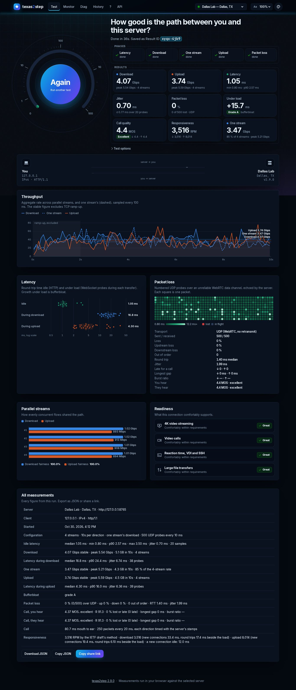

# texas2step

**Throughput, latency, jitter and packet loss between endpoints, measured from a web
browser.** Open the page and press Start. texas2step measures the path between you
and the server with multi-stream HTTP transfers, latency probes idle and under load,
and real UDP packet loss over WebRTC, then shows every figure as discrete metrics and
graphs. The same measurements are available as a REST API, a command-line client, and
server-to-server functions.


Inspired by [speed.cloudflare.com](https://speed.cloudflare.com)
([cloudflare/speedtest](https://github.com/cloudflare/speedtest)), but self-hosted: a
Python server, a dependency-free TypeScript client, and no third-party services, so it
works on air-gapped and internal networks.

New to texas2step? [texas2step at a glance](docs/at-a-glance.md) shows what it does and
where it helps, on one page.

## What it measures

| Metric | How | Transport |
|---|---|---|
| **Latency** | 20 keep-alive pings, timed with Resource Timing, server time removed | HTTP |
| **Jitter** | Mean absolute difference between consecutive RTTs | HTTP |
| **Download / upload** | N parallel streams for T seconds, 100 ms timeline, ramp-up excluded | HTTP |
| **One stream** | One stream's download for the same time: what a single file copy gets | HTTP |
| **Rate limit** | A rate that holds, then steps down and stays down: a shaper, a policer or the end of a speed boost | derived |
| **Latency under load** | Probes every 250 ms on a separate connection during each transfer, graded A+ to F | WebSocket |
| **Packet loss** | Numbered probes on an unreliable data channel, echoed and stamped by the server; each direction's loss and delay apart | UDP (WebRTC) |
| **Stream fairness** | Per-stream rates and Jain's index | HTTP |
| **Call quality** | A G.711 call's MOS (1 to 5) each way, from the ITU-T E-model: delay, and packets lost, late or in bursts | derived |
| **Responsiveness** | Round trips per minute under load, on new connections and the loaded one, as the IETF draft and macOS's `networkQuality` count them | HTTP, WebSocket |
| **Readiness** | Grades for streaming, video calls, reaction time/VDI/SSH and bulk transfers | derived |

Details and definitions: [docs/methodology.md](docs/methodology.md). What the scores mean
to the people using a connection: [docs/experience.md](docs/experience.md).



The UI has six views: **Test** (gauge, live link animation, charts, exportable and
shareable results), **Monitor** (continuous UDP probing with a scrolling RTT and loss
trace, to one server or to two at once for a side-by-side comparison, or a voice or video
call's packets scored every 10 seconds), **Diag** (HTTP/1.1,
HTTP/2 and HTTP/3, WebSocket and UDP over IPv4 and IPv6, tried once a second, with your addresses, NAT,
TLS and an event log), **History** (saved runs and trend), **?** (what the tool does, in plain
words, for anyone), and **API** (copy-ready examples). A site can hide any of them
(`page_test`, `page_monitor`, `page_diag`, `page_history`, `page_help`, `page_api`). Every
chart has a hover readout and a table equivalent.

Visitors pick a theme from the header: Light, Dark, America, Energy, Federal, Military or
Texas, or one that follows the OS. A page-size drop-down beside it (70% to 125%) fits more on smaller screens. Operators can rename the site, add their logo, organization and
support links, show a notice on every page and set the default theme; see
[Branding and themes](docs/configuration.md#branding-and-themes).

## Install

On an Ubuntu 26.04 LTS server that already runs nginx, install the Debian package from
the [releases page](https://github.com/robert-patrick-texas/texas2step/releases) and add
one line to your site's `server { }` block:

```bash
sudo apt install ./texas2step-*-amd64.deb        # the package from the releases page
#   in /etc/nginx/sites-available/<your site>:  include snippets/texas2step.conf;
sudo nginx -t && sudo systemctl reload nginx     # → https://www.example.net/texas2step/
```

Or let `texas2step-setup`, which ships next to the `.deb`, check the server first. It
reports what it will change and what you must fix, then writes an install script for
that server. The script installs, reinstalls or upgrades texas2step, merges your
settings into the new template, publishes it through nginx and opens the UDP range:

```bash
sudo ./texas2step-setup --id houston --name "houston.example.net" --location "Houston, TX"
sudo ./texas2step-install.sh                     # after reading it
```

Once installed, `sudo texas2step update` upgrades it to the newest release, and a timer
can do that unattended. On a server without internet access,
`sudo texas2step update --from <directory>` installs a release whose two files you put
there. The [install guide](docs/install.md) covers the rest: the setup
tool's options, the optional `/speedtest` address, configuration, the firewall rule for
the UDP test, updates, clearing saved results, cloning a server and removal.

To run it from source instead:

```bash
uv sync && uv run texas2step serve      # http://localhost:8080
```

Building, testing, the docs site and packaging are covered in
[docs/development.md](docs/development.md).

## Command line

**t2s** is the command-line client to copy onto any workstation or server: one file for
Linux, macOS or Windows, with nothing to install, that runs the Test page's full test or
any part of it, Monitor and Diag ([t2s](docs/t2s.md)):

```bash
curl -fLo t2s https://github.com/robert-patrick-texas/texas2step/releases/latest/download/t2s-linux-amd64
chmod +x t2s
./t2s run https://www.example.net/texas2step
./t2s monitor https://dallas.example.net/texas2step https://houston.example.net/texas2step
./t2s diag https://www.example.net/texas2step
```

The server's package also has a command line in Python, `texas2step`, with the same tests:
installed as `/usr/bin/texas2step`, or elsewhere from PyPI with `uv tool install texas2step`
(or `pipx install texas2step`).

```bash
texas2step run https://www.example.net/texas2step              # full test, human-readable
texas2step run https://www.example.net/texas2step --json --save
texas2step latency  https://www.example.net/texas2step --count 50
texas2step download https://www.example.net/texas2step --streams 8 --seconds 15
texas2step upload   https://www.example.net/texas2step
texas2step loss     https://www.example.net/texas2step --packets 1000 --interval 5
```

```
client 127.0.0.1 (IPv4, HTTP/1.1)
this computer 127.0.0.1

  Latency               1.85 ms   jitter 0.08 ms   (min 1.63 · p90 2.03 · 20 samples)
  Download         4,893.9 Mbps   peak 5,554.3   (2 streams · loaded -0.8 ms)
  One stream       5,720.1 Mbps   peak 6,167.7   (a single file copy · 117 % of 2 streams)
  Upload           8,681.2 Mbps   peak 11,391.7   (2 streams · loaded +0.1 ms)
  Loss                   0.00 %   (0/200 lost · ↑ 0.00 % ↓ 0.00 % · UDP RTT 1.19 ms · jitter 0.12 ms)
  Call quality          4.4 MOS   excellent   (you hear 4.4 · they hear 4.4 · longest gap ↓ 0 ↑ 0 ms · late ↓ 0.00 % ↑ 0.00 %)
  Responsiveness     28,501 RPM   (↓ 50,014 · ↑ 28,501 · a new connection 1.0 ms idle, 4.7 ms under load)
  Bufferbloat                A+
```

`client` is the address the server sees; `this computer` is the CLI's own on that
connection, before any NAT, with the interface's MAC address on Linux. `--save` stores
both with the result, and `--no-local` leaves them out.

## API

Every primitive is a plain HTTP endpoint (`/api/v1/ping`, `/down`, `/up`, `/ws`,
`/rtc/offer`), and a server can measure toward another server on request:

```bash
curl -o /dev/null 'https://www.example.net/texas2step/api/v1/down?bytes=1000000000'
curl -s -X POST https://dallas.example.net/texas2step/api/v1/measure/full \
     -H 'content-type: application/json' -d '{"target": "https://houston.example.net/texas2step"}'
```

Full reference: [docs/api.md](docs/api.md), or `/api/docs` on a running server.

## Several locations

List other texas2step servers in the config and they appear in the header's server
picker. The browser tests the chosen server directly (cross-origin), and each server can
measure the others through the API. See [docs/configuration.md](docs/configuration.md).
For servers open to the Internet, see [Access codes](docs/access.md).

## Documentation

* [At a glance](docs/at-a-glance.md): what texas2step does and where it helps, on one
  page, also as a PDF to print on [US Letter](docs/at-a-glance.pdf) or
  [A4](docs/at-a-glance-a4.pdf).
* [Install](docs/install.md): the Ubuntu package, nginx, firewall, upgrades.
* [t2s](docs/t2s.md): the command-line client for Linux, macOS and Windows: tests,
  Monitor and Diag from any computer, and how it updates itself.
* [Configuration](docs/configuration.md): every setting.
* [Access codes](docs/access.md): servers open to the Internet, a code from the service
  desk, and the desk's tools kept to your networks.
* [Traffic limits](docs/traffic.md): a daily and monthly cap on what the tests move,
  for servers whose traffic is billed.
* [Active clients](docs/clients.md): who is using the server now, page by page, without
  cookies.
* [Server CPU](docs/cpu.md): the workers' CPU beside what they serve, over 30 days;
  refusing tests while the host is busy with other work; and results that say when the
  server, not the network, set the rate.
* [Security](docs/security.md): the security controls, what each guards against, and
  what is left to the operator.
* [Methodology](docs/methodology.md): what is measured, and how.
* [Quality and user experience](docs/experience.md): what the call-quality score and
  responsiveness mean to the people using a connection, the adjustments texas2step makes
  to match what they notice, and the sources.
* [API](docs/api.md): endpoints and the UDP probe protocol.
* [Development](docs/development.md): running from source, tests, docs site, packaging,
  releases.
* [Roadmap](docs/roadmap.md): ideas for future work.

The same pages are published at
[robert-patrick-texas.github.io/texas2step](https://robert-patrick-texas.github.io/texas2step/).

## License

Copyright 2026 Robert Patrick. Licensed under the [Apache License 2.0](LICENSE.md).
