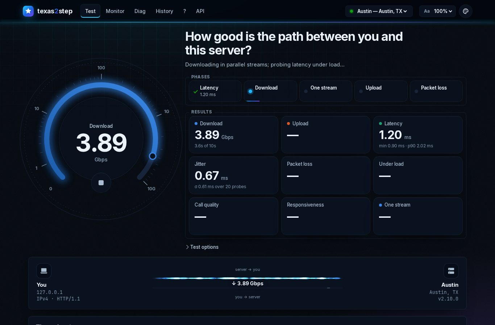
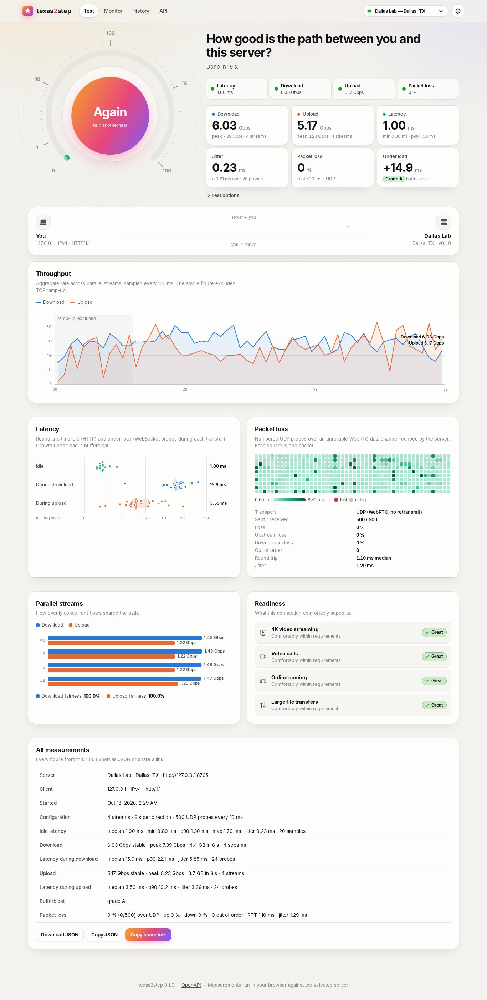

# texas2step

**Throughput, latency, jitter and packet loss between endpoints, measured from a web
browser.** Open the page and press Start. texas2step measures the path between you
and the server with multi-stream HTTP transfers, latency probes idle and under load,
and real UDP packet loss over WebRTC, then shows every figure as discrete metrics and
graphs. The same measurements are available as a REST API, a Python CLI, and
server-to-server functions.



Inspired by [speed.cloudflare.com](https://speed.cloudflare.com)
([cloudflare/speedtest](https://github.com/cloudflare/speedtest)), but self-hosted: a
Python server, a dependency-free TypeScript client, and no third-party services, so it
works on air-gapped and internal networks.

## What it measures

| Metric | How | Transport |
|---|---|---|
| **Latency** | 20 keep-alive pings, timed with Resource Timing, server time removed | HTTP |
| **Jitter** | Mean absolute difference between consecutive RTTs | HTTP |
| **Download / upload** | N parallel streams for T seconds, 100 ms timeline, ramp-up excluded | HTTP |
| **Latency under load** | Probes every 250 ms on a separate connection during each transfer, graded A+ to F | WebSocket |
| **Packet loss** | Numbered probes on an unreliable data channel, echoed; up- and downstream loss separated | UDP (WebRTC) |
| **Stream fairness** | Per-stream rates and Jain's index | HTTP |
| **Readiness** | Grades for streaming, video calls, reaction time/VDI/SSH and bulk transfers | derived |

Details and definitions: [docs/methodology.md](docs/methodology.md).



The UI has four views: **Test** (gauge, live link animation, charts, exportable and
shareable results), **Monitor** (continuous UDP probing with a scrolling RTT and loss
trace, to one server or to two at once for a side-by-side comparison), **History** (saved runs and trend), and **API** (copy-ready examples). Every
chart has a hover readout and a table equivalent.

Visitors pick a theme from the header: Light, Dark, America, Energy, Federal, Military or
Texas, or one that follows the OS. A page-size drop-down beside it (70% to 125%) fits more on smaller screens. Operators can rename the site, add their logo, organization and
support links, show a notice on every page and set the default theme; see
[Branding and themes](docs/configuration.md#branding-and-themes).

## Install

On an Ubuntu 26.04 LTS server that already runs nginx, install the Debian package from
the [releases page](https://github.com/robert-patrick-texas/texas2step/releases) and add
one line to your site's `server { }` block:

```bash
sudo apt install ./texas2step-*-amd64.deb        # the package from the releases page
#   in /etc/nginx/sites-available/<your site>:  include snippets/texas2step.conf;
sudo nginx -t && sudo systemctl reload nginx     # → https://www.example.net/texas2step/
```

Or let `texas2step-setup`, which ships next to the `.deb`, check the server first. It
reports what it will change and what you must fix, then writes an install script for
that server. The script installs, reinstalls or upgrades texas2step, merges your
settings into the new template, publishes it through nginx and opens the UDP range:

```bash
sudo ./texas2step-setup --id houston --name "houston.example.net" --location "Houston, TX"
sudo ./texas2step-install.sh                     # after reading it
```

The [install guide](docs/install.md) covers the rest: the setup tool's options, the
optional `/speedtest` address, configuration, the firewall rule for the UDP test,
upgrades and removal.

To run it from source instead:

```bash
uv sync && uv run texas2step serve      # http://localhost:8080
```

Building, testing, the docs site and packaging are covered in
[docs/development.md](docs/development.md).

## Command line

The CLI runs the same engine from any host toward a texas2step server. The package
installs it as `/usr/bin/texas2step`; elsewhere,
`uv tool install git+https://github.com/robert-patrick-texas/texas2step` installs it.

```bash
texas2step run https://www.example.net/texas2step              # full test, human-readable
texas2step run https://www.example.net/texas2step --json --save
texas2step latency  https://www.example.net/texas2step --count 50
texas2step download https://www.example.net/texas2step --streams 8 --seconds 15
texas2step upload   https://www.example.net/texas2step
texas2step loss     https://www.example.net/texas2step --packets 1000 --interval 5
```

```
client 127.0.0.1 (IPv4, HTTP/1.1)

  Latency            1.26 ms   jitter 0.09 ms   (min 1.17 · p90 1.53 · 20 samples)
  Download      6,240.5 Mbps   peak 6,543.6   (2 streams · loaded -0.5 ms)
  Upload       13,624.1 Mbps   peak 14,188.3   (2 streams · loaded -0.1 ms)
  Loss                0.00 %   (0/200 lost · ↑ 0.00 % ↓ 0.00 % · UDP RTT 0.92 ms · jitter 0.10 ms)
  Bufferbloat             A+
```

## API

Every primitive is a plain HTTP endpoint (`/api/v1/ping`, `/down`, `/up`, `/ws`,
`/rtc/offer`), and a server can measure toward another server on request:

```bash
curl -o /dev/null 'https://www.example.net/texas2step/api/v1/down?bytes=1000000000'
curl -s -X POST https://dallas.example.net/texas2step/api/v1/measure/full \
     -H 'content-type: application/json' -d '{"target": "https://houston.example.net/texas2step"}'
```

Full reference: [docs/api.md](docs/api.md), or `/api/docs` on a running server.

## Several locations

List other texas2step servers in the config and they appear in the header's server
picker. The browser tests the chosen server directly (cross-origin), and each server can
measure the others through the API. See [docs/configuration.md](docs/configuration.md).

## Documentation

* [Install](docs/install.md): the Ubuntu package, nginx, firewall, upgrades.
* [Configuration](docs/configuration.md): every setting.
* [Methodology](docs/methodology.md): what is measured, and how.
* [API](docs/api.md): endpoints and the UDP probe protocol.
* [Development](docs/development.md): running from source, tests, docs site, packaging,
  releases.

The same pages are published at
[robert-patrick-texas.github.io/texas2step](https://robert-patrick-texas.github.io/texas2step/).

## License

Copyright 2026 Robert Patrick. Licensed under the [Apache License 2.0](LICENSE.md).
